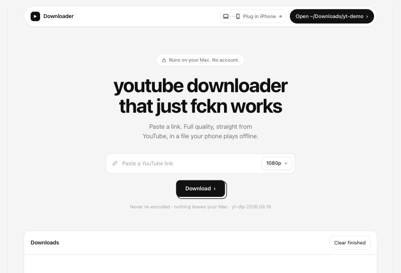

# ytstash

**A YouTube downloader that just works.** Paste a link, get a full-quality file your iPhone plays offline — on a plane, a train, or hotel wifi that gave up.



A small Flask web UI over [yt-dlp](https://github.com/yt-dlp/yt-dlp) that runs on your Mac. No account, no cloud, nothing leaves your machine.

## Features

- **Never re-encodes.** Every step is a stream copy, so files arrive at line speed and original quality.
- **Phone-native by default.** H.264/AAC, the combo iOS hardware-decodes, so the phone stays cool and the battery lasts. Best quality, a height cap, or audio-only are one click away.
- **Built for watching offline.** Chapters (Infuse turns them into skip points), embedded subtitles and cover art, sponsor segments cut via SponsorBlock.
- **iPhone sync.** Plug in your iPhone and finished downloads copy straight into [Infuse](https://firecore.com/infuse) over USB, sorted into one folder per day.
- **Pause, resume, retry, cancel.** Up to two downloads run in parallel, the rest queue.
- **Self-updating.** yt-dlp updates itself on start, so YouTube changes don't break it for long.
- **Mac-friendly.** Keeps the Mac awake mid-download, chimes when done, picks up links from your clipboard, and sends deletes to the Trash.
- **Phone-only mode.** [`phone.py`](phone.py) is a single file that runs in [a-Shell](https://holzschu.github.io/a-Shell_iOS/) on the iPhone itself.

## Quick start

Requires macOS, [uv](https://docs.astral.sh/uv/) and ffmpeg.

```bash
brew install ffmpeg
git clone https://github.com/ilyaskhalid/ytstash.git
cd ytstash
uv run app.py
```

The UI opens at <http://127.0.0.1:8765>. Downloads land in `~/Downloads/yt/<date>/`.

| Flag | What it does |
|------|--------------|
| `--lan` | Serve on your local network so your phone can use it. There's no login, so use it on networks you trust. |
| `--no-update` | Skip the yt-dlp update check on start. |
| `--self-check` | Run the built-in checks and exit. |

## How it works

| File | Role |
|------|------|
| [`app.py`](app.py) | Flask server, download queue, and the single-page UI |
| [`ytdlp_opts.py`](ytdlp_opts.py) | Everything that touches yt-dlp's options: formats, postprocessors, paths |
| [`quality.py`](quality.py) | Quality presets |
| [`iphone.py`](iphone.py) | USB sync into Infuse via [pymobiledevice3](https://github.com/doronz88/pymobiledevice3) |
| [`system.py`](system.py) | macOS integration: caffeinate, Finder, clipboard, Trash |
| [`phone.py`](phone.py) | Standalone downloader for a-Shell on iOS |

## Disclaimer

Only download content you own or have permission to download. Respect YouTube's Terms of Service and the rights of creators.

## License

[MIT](LICENSE)
